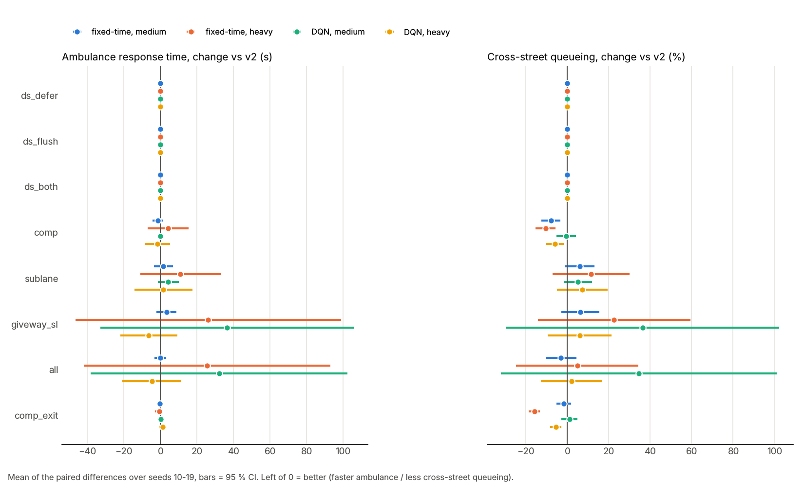

# W4: corridor completion — downstream check, recovery compensation, sublane give-way

Real SUMO runs (SUMO 1.28.0, libsumo), cloud session, 15–16 Nov 2026. Workstream W4 of FYP-II.
Each addition from D2 §5.6 / Algorithm 2 that corridor v2 (task 3.7) did not have yet was
tested on its own against **corridor v2** (paired, same seeded demand), then together. Nothing
beyond SUMO itself is simulated; the DQN was not retrained.

## Setup

- Main study = the task 3.7 setup: synthetic 3×3 grid (not Lahore yet), dynamic routing, no
  incident, ambulance dispatched at 1,200 s from `left0A0` to `C2top2`, 900 s warm-up + 900 s
  measurement, **medium and heavy demand**, background signals **fixed-time** (`fixed_time/`)
  and **DQN** (`dqn/`), **new seeds 10–19** (task 3.7 used 0–4; dev seeds 100–101 never used).
- Stress case (`stress_spillback/`), added because the downstream check never fires in the
  main study: static routing (the ambulance cannot avoid the problem), obstruction (speed limit
  3 m/s) on `A2B2` from 900 s, heavy demand, fixed-time, seeds 10–19, 1,800 s measurement so
  every ambulance arrives. This is a deliberately constructed case, not a typical one.
- 470 runs in the tables (+50 `v2` reruns in `*/extra_comp_exit/` that reproduced the main
  `v2` response times exactly). Every ambulance arrived.

Reproduce (about 30 min on 4 CPU cores):

```bash
python -m manzil.experiments.emergency_w4_study --out results/fyp2/corridor/fixed_time
python -m manzil.experiments.emergency_w4_study --controller dqn --out results/fyp2/corridor/dqn
python -m manzil.experiments.emergency_w4_study --stress --out results/fyp2/corridor/stress_spillback
python -m manzil.experiments.emergency_w4_report results/fyp2/corridor
```

(`comp_exit` was added after the first pass and run with `--arms v2 comp_exit` into
`<study>/extra_comp_exit/`, then merged into `<study>/results.csv`; `v2` was checked identical.)

## Arms

| Arm | What changes vs v2 |
|---|---|
| `v2` | reference: corridor v2 (look-ahead 2, activation at ETA ≤ 15 s + queue clearance, min-green truncation 5 s for corridor requests, route-index fix) |
| `off` | no corridor (context) |
| `ds_defer` | downstream check: a due activation waits (≤ 20 s) while the exit edge is blocked (≥ 75 % of its storage occupied and someone halting) |
| `ds_flush` | downstream check: the junction at the end of a blocked exit is activated at once (may be one beyond the look-ahead) |
| `ds_both` | defer + flush |
| `comp` | bounded compensation: after confirmed passage the corridor keeps the junction and serves the most-queued phase the priority denied, for as long as the junction was held (10–20 s), only after a full 10 s minimum green, then returns it |
| `comp_exit` | as `comp`, but the junction goes back to normal control at passage and is taken back for compensation only once the ambulance has left its exit edge |
| `sublane` | SUMO sublane model (`--lateral-resolution 0.8`) for all vehicles, no give-way (fair reference for the next arm) |
| `giveway_sl` | sublane model + SUMO bluelight device on the ambulance, so ordinary vehicles move aside (rescue lane); speed mode 31 set again so the ambulance still stops at red |
| `all` | `ds_both` + `comp` + `giveway_sl` |

## Results

Full table: `key_table.md` / `key_table.csv`; per study `*/summary.md` (all metrics, 95 % CIs,
seeds better); per run `*/runs/*/metrics.json` and `mission.json` (corridor events, stop log).
Δ = mean paired difference vs `v2` over 10 seeds (± half-width of the 95 % CI), then the number
of seeds where the arm was strictly better (ties count as not better).

| Background, demand | v2 response | `comp` | `comp_exit` | `giveway_sl` | `comp_exit` cross-street queueing | `comp_exit` network queue |
|---|---|---|---|---|---|---|
| fixed-time, medium | 102.1 s | −1.5 (±2.8), 2/10 | −0.3 (±0.7), 1/10 | +3.3 (±5.4), 3/10 | −1.5 % | +0.3 veh |
| fixed-time, heavy | 127.7 s | +4.2 (±11.1), 4/10 | −0.7 (±2.3), 4/10 | +26.2 (±72.6), 5/10 | **−15.8 %** | −1.1 veh |
| DQN, medium | 99.8 s | +0.0 (±1.3), 3/10 | +0.2 (±0.5), 0/10 | +36.5 (±69.3), 3/10 | +1.1 % | +0.3 veh |
| DQN, heavy | 128.8 s | −1.7 (±6.9), 2/10 | +1.2 (±2.0), 2/10 | −6.4 (±15.6), 6/10 | −5.4 % | −2.7 veh |
| stress (spillback) | 233.9 s | +9.8 (±15.4), 3/10 | +6.2 (±19.5), 5/10 | — | −3.5 % | +0.8 veh |



`response_and_cost.png`: paired change vs v2 in ambulance response time (s, left) and in
cross-street queueing (%, right), mean and 95 % CI per arm, for the four main-study cells
(the stress case is in the table only).

### 1. Downstream-capacity check: never needed on the grid, harmful when it fires — rejected

- Main study: no exit edge on the ambulance's route ever reached the 75 % threshold (highest
  seen in 6 instrumented exploratory heavy runs ≈ 25 %). `ds_defer`, `ds_flush` and `ds_both`
  were **identical to v2 in all 120 of their runs** (3 arms × 2 demands × 2 controllers ×
  10 seeds; 0 deferrals, 0 flushes). In the stress case they fired 22 times in 30 runs.
- Stress case (exits did fill, up to 94 %): defer +7.0 s (1/10 better), flush +80.5 s (0/10),
  both +99.8 s (0/10). Flushing holds the downstream junction early; the queue there is caused
  by the obstruction, not the signal, so the hold does not drain it, runs into the 60 s
  priority limit and re-requests. Deferring only postpones the green the ambulance needs.
- Kept as an off-by-default, tested option (`MissionConfig.downstream`), because D2 lists the
  check. Worth re-testing on the Lahore network, where real spillback may occur.

### 2. Bounded compensation in recovery: kept in the `comp_exit` form

- `comp` (compensate at passage) cut cross-street queueing by 6–11 % (except DQN medium), but
  its ambulance cost was heavy-tailed: 3 runs were 32–57 s slower, with more "queue in front"
  time (fixed-time heavy 11.5 → 16.1 s): the cross-street traffic it releases turns onto the
  ambulance's exit edge just ahead of it.
- A first version also compensated after a **timeout/cancellation**; the ambulance then met
  reds at junctions it still had to cross (DQN heavy 1.7 s, stress 4.6 s "red, outside
  look-ahead", 0 in v2). Fixed before the final runs: compensation only after confirmed passage
  (test `test_no_compensation_after_cancellation`).
- `comp_exit` waits until the ambulance has left the exit edge. Main study: ambulance median
  change 0 s in every cell, mean within ±1.2 s with CIs of ±0.5 to ±2.3 s (no measurable cost);
  cross-street queueing −15.8 % (fixed-time heavy) and −5.4 % (DQN heavy), ≈ 0 at medium
  demand; network queue −1.1 / −2.7 vehicles at heavy demand. Recovery time: fixed-time heavy
  20.0 → 15.2 s, DQN heavy 11.4 → 14.4 s (it is measured from passage and the compensation
  starts later). Stress case: +6.2 s (±19.5), median −0.5 s, but two seeds +43 s and +65 s.
- Decision: **recommended corridor setting = v2 + compensation (`compensation=True`,
  `compensation_start="exit_clear"`)**. It is left **off by default** in the code for now, so
  the published Phase 3/5 results stay reproducible; switching the default (and rerunning
  Phase 3/5) is for the coordinator, ideally together with the Lahore rerun.

### 3. Give-way with the sublane model: collisions — rejected

- **Decision 11 holds:** 0 red-light crossings in every give-way run (speed mode 31 restored,
  every stop-line crossing logged).
- But SUMO reported **13 collisions in the 40 `giveway_sl` runs** (14 in the 40 `all` runs)
  and 0 in the other 390 runs. The one inspected (heavy, seed 10) was an ordinary car driving
  into the ambulance inside junction A0 during its permissive left turn. Teleports followed.
- The sublane model alone (no device) already cost ordinary traffic (cross-street queueing
  +5 to +12 %, mean waiting +0.8 to +2.2 s), because it changes every vehicle's lane-change
  behaviour; it did shorten the ambulance's insertion wait at heavy fixed-time (2.1 → 0.1 s).
- Ambulance gains from give-way are inconsistent (DQN heavy −6.4 s, 6/10; fixed-time heavy
  +26.2 s, DQN medium +36.5 s, from runs where it got stuck). Rejected; kept as an option
  (`MissionConfig.sublane`, `give_way`) for a future SUMO version or junction model.

### Safety

0 safety-monitor violations and 0 ambulance red-light crossings in all 470 runs. 0 collisions
in every arm without the bluelight device.

## Limits

Synthetic 3×3 grid, one origin–destination pair, one ambulance, 10 seeds per cell. The grid's
two-phase programs give every phase only one "denied" phase, so compensation choice is trivial
here; Lahore junctions with more phases will test the phase choice. The stress case is
constructed to make exits fill.

## Code

`manzil/corridor/coordinator.py` (downstream check, compensation), `manzil/experiments/emergency.py`
(`MissionConfig` fields, corridor housekeeping after arrival), `manzil/sim/adapter.py`
(`sublane_model`, `extra_args`), `manzil/experiments/emergency_w4_study.py`,
`emergency_w4_report.py`. Tests: `tests/test_w4_corridor.py`.

Measurement change (applies to every arm here): after the ambulance arrives the corridor keeps
being stepped, so recoveries that end after arrival are now measured instead of left open.
