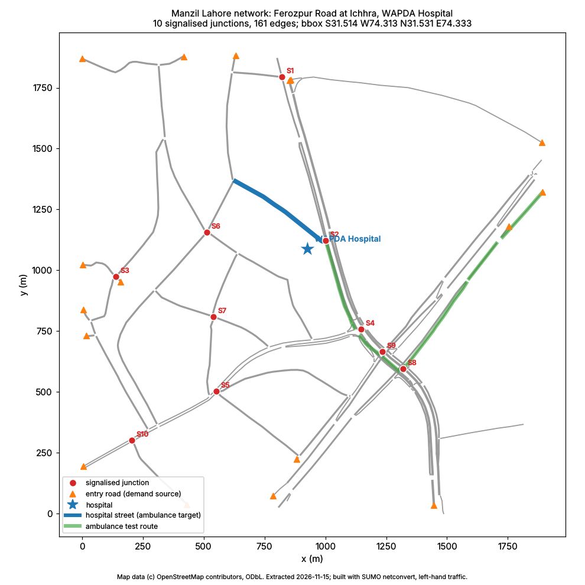

# Scenario: Lahore, Ferozpur Road at Ichhra (`lahore`)

A real road network built from **OpenStreetMap**, as D2 planned (workstream W1). It replaces the synthetic 3×3 grid for FYP-II experiments. Because all Manzil code reads the network from the `.net.xml`, the same controllers, safety filter, routing and corridor run on it unchanged (scenario name `lahore`).

Map data © OpenStreetMap contributors, available under the [Open Database Licence (ODbL)](https://www.openstreetmap.org/copyright). The network file is a derived database; keep this attribution wherever the network, the map or results drawn from it appear (report, slides, dashboard).



## Area (chosen by Ibrahim, 15 Nov 2026)

| | |
|---|---|
| Area | Ferozpur Road at Ichhra, Lahore, with the Canal crossing; matches the W2 videos (elevated Metro Bus track) |
| Bounding box | S 31.514, W 74.313, N 31.531, E 74.333 (about 1.9 km × 1.9 km) |
| Hospital | WAPDA Hospital (OSM node at 31.52382, 74.32281); the ambulance target is the street edge `25036926` (Fazal Elahi Road), the nearest street that is not the Ferozpur Road flyover |
| Signalised junctions | 10 traffic lights, each over one junction (`S1`–`S10` on the map) |
| Edges | 161 (roads of class tertiary and above) |
| Entry / exit roads | 17 / 17 dead-end fringe roads |
| Driving side | left (`--lefthand`), as in Pakistan |

Two other Ferozpur Road areas were measured before the choice (Ghazi Chowk with Lahore General Hospital; Model Town with Children's Hospital): see `results/fyp2/lahore_network/README.md`.

## How the network is built

```bash
python -m manzil.scenarios.osm --fetch    # download the raw OSM extract again (needs internet)
python -m manzil.scenarios.osm            # rebuild from the committed raw extract
python -m manzil.scenarios.osm --validate # checks + controller runs -> results/fyp2/lahore_network/
```

1. **Extract** (`osm/ichhra.raw.osm.xml.gz`, 130 KB): the bounding box from the OSM API (`/api/0.6/map`) in 0.01° tiles, merged. Extracted **2026-11-15T21:56:27Z**, sha256 `6b83f676d073d9bc32c6c6a8a705fe863b54947b51c5b2e361ff6c74006a6773` (`osm/ichhra.extract.json`). The build refuses to run if the checksum does not match.
2. **Filter and clip**: keep `trunk`, `primary`, `secondary`, `tertiary` and their `_link` roads; cut ways at the box edge. Residential and service streets are dropped.
3. **netconvert** with `lahore.typ.xml` (urban speeds: 60 km/h primary/trunk, 50 secondary, 40 tertiary and links; motor vehicles only), junction joining (25 m), ramp and roundabout guessing, traffic-light guessing (threshold 40 m/s lane-speed sum), left-hand traffic, OSM layers as elevation (flyovers and underpasses do not create junctions). The full command is in `network.json`.
4. **Cleanup**, repeated until nothing changes:
   - signals: netconvert's guessed lights at pure **merge points** (at most two approaches, straight movements only) are removed (12 removed);
   - connectivity: edges not on a path from a feeder to a drain of the network's largest strongly connected part are removed (5 one-way fragments left by clipping). Afterwards every entry reaches every exit and the hospital.
5. `signals.json` is generated from the network (see below).

Rebuilding gives the same network: `content_sha256` in `network.json` (`2986a3bf7220…`, the SHA-256 without SUMO's "generated on" line) is checked by `tests/test_w1_lahore.py`.

## Important limitations (say these when presenting results)

- **Signals are guessed, not surveyed.** OSM has *no* `traffic_signals` tags in this box, so all 10 lights come from netconvert's guessing rule plus the cleanup above. Their positions and phase plans are plausible, not the real Lahore signals. A team member who knows Ichhra could check the `S1`–`S10` list in `results/fyp2/lahore_network/README.md`.
- **Speeds are assumed** (urban type map), except where OSM has `maxspeed`.
- **Lane counts** come from OSM `lanes` tags where present, otherwise from the type map.
- **Demand is synthetic** (Poisson, calibrated for congestion level, not to real counts). W6 compares with the video counts.
- Traffic is cars only (one SUMO `passenger` type), like the grid; Lahore's motorcycles and rickshaws are not modelled here.
- Traffic lights are not joined (`join_tls = False`): close junction nodes are merged into one junction instead. The network reader supports joined lights (one light over several junctions), but the DQN observation layout (`manzil/control/rl_env.py`, W3) allows at most 4 approaches and 4 green phases, and the joined Ichhra lights had up to 10 approaches.

## Signal timing (`signals.json`, version 1)

- Safety timing as on the grid: min green 10 s, yellow 3 s, all-red 2 s, max red 90 s, corridor min green 5 s.
- Fixed-time plan `netconvert`: the green durations of netconvert's program (17–42 s), raised to at least 10 s; no offsets. **Not tuned for Lahore.**
- Adaptive: the grid parameters, not retuned. DQN: the grid checkpoint `models/dqn/grid3x3/best.pt`, **not retrained** (transfer test).

## Demand

`manzil.scenarios.osm.build_lahore_demand(profile, seed, duration_s, net_file, out_dir)` writes the same files as `manzil.scenarios.demand.build_demand` (trips, duarouter routes, `.sumocfg`, manifest). Poisson arrivals per entry road at *rate × lanes*; destinations weighted by exit lanes. "Major" entries are those heading mainly north–south (the Ferozpur Road axis).

| Profile | veh/h per entry lane (major / minor) | Meaning |
|---|---|---|
| light | 50 / 50 | free flow |
| medium | 100 / 100 | busy but stable |
| heavy | 125 / 125 | onset of saturation (waiting time doubles, see calibration) |
| uneven | 150 / 30 | busy Ferozpur Road axis, quiet cross streets |

Rates were chosen from a sweep with netconvert's default signals on dev seeds 100–101 (`results/fyp2/lahore_network/demand_calibration.csv`).

The experiment runner (`manzil/experiments/runner.py`) still calls the grid demand generator. Until it can pick the generator per scenario (request to W3 in `docs/workstreams/W1.md`), use `manzil.scenarios.osm.controller_runs`, which swaps in the Lahore generator.
